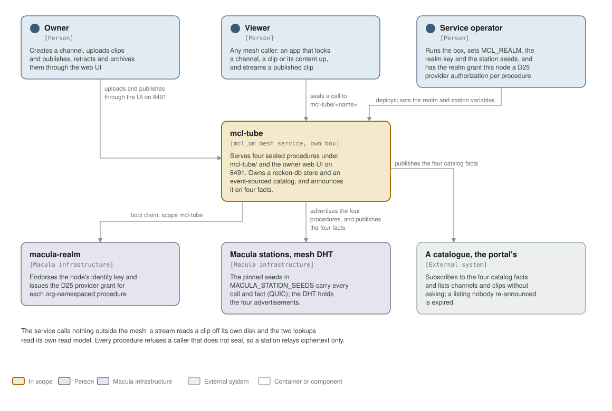
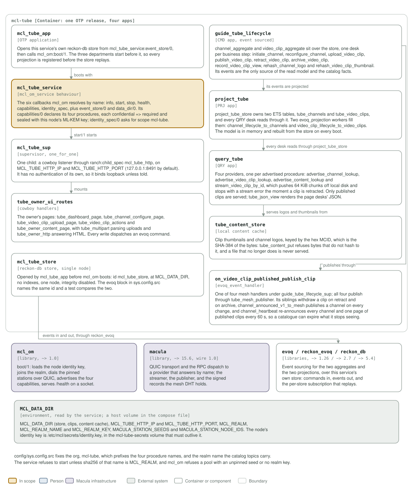

# mcl-tube architecture: C4 model

*This exists so a reader can see what mcl-tube talks to, and what it is made of,
without reading it.*

**Status: four apps, one release, one store.** The service opens its own
reckon-db store, event-sources the channel and clip lifecycles, projects them
into an in-memory read model, and answers four sealed procedures of its own plus
the open `info` and `get_limits` `mcl_om` adds to every service, and the owner
web UI on 8491. It calls nothing outside the mesh.

## Level 1: system context

| Element | Kind | Role |
| --- | --- | --- |
| mcl-tube | In scope | Serves `mcl-tube/lookup_channel`, `lookup_video_clip`, `lookup_content` and the `watch_video_clip` stream, all `confidential => required`, plus the owner web UI on 8491. One OTP release in one container, an `mcl_om` mesh service on its own box |
| Owner | Person | Creates a channel and uploads, publishes, retracts and archives clips through the local web UI, which has no authentication of its own and binds loopback |
| Viewer | Person | Any mesh caller: an app that looks a channel, a clip or its content up, and streams a published clip. Every SDK seals by default, so a caller that does not seal is refused with `sealed_required` |
| Service operator | Person | Runs the box, sets `MCL_REALM`, `MCL_REALM_KEY` and the station seeds, and has the realm grant this node a D25 provider authorization for the org `mcl-tube` |
| macula-realm | Macula infrastructure | Endorses the node's identity key and issues the provider grant for each org-namespaced procedure |
| Macula stations, mesh DHT | Macula infrastructure | The pinned seeds in `MACULA_STATION_SEEDS` carry every call and fact over QUIC; the DHT holds one advertisement per procedure, its own four and `mcl_om`'s `info` and `get_limits`, each naming this node's ML-KEM key |
| A catalogue, the portal's | External system | Subscribes to the four catalog facts under `io.macula/mcl-tube/tube/catalog/`, lists a channel or clip without asking, and expires a listing nobody re-announced |

The service calls nothing outside the mesh: a stream reads a clip off its own
disk and the two lookups read its own read model. What a catalogue or a viewer
holds is what this node published or advertised, not a call it makes out.

## Level 2: containers and components

| Component | Technology | Responsibility |
| --- | --- | --- |
| `mcl_tube_app` | OTP application | Opens the store from `mcl_tube_service:event_store/0`, then `mcl_om:boot/1`. The three departments start before it, so every projection is registered before the store replays |
| `mcl_tube_service` | the `mcl_om_service` behaviour | The six callbacks `mcl_om` resolves by name, plus `event_store/0` and `data_dir/0`. `capabilities/0` declares the four procedures of its own and names each provider module, so the providers are wired here and nowhere else |
| `mcl_tube_sup` | supervisor, `one_for_one` | One child: a cowboy listener on `MCL_TUBE_HTTP_IP`:`MCL_TUBE_HTTP_PORT` (127.0.0.1:8491), carrying the owner pages and `query_tube_sup:routes/0` on the same socket |
| `tube_owner_ui_routes` | cowboy handlers | `tube_dashboard_page`, `tube_channel_configure_page`, `tube_video_clip_upload_page`, `tube_video_clip_actions` and `tube_owner_content_page`, with `tube_multipart` and `tube_owner_http`. Every write dispatches an evoq command |
| `mcl_tube_store` | reckon-db store, single node | This service's own store, id `mcl_tube_store` at `MCL_DATA_DIR`. The evoq block in `sys.config.src` names the same id and a test compares the two |
| `guide_tube_lifecycle` | CMD app, event sourced | `channel_aggregate` and `video_clip_aggregate`, one desk per business step: initiate, reconfigure, upload, publish, retract, archive, record a view, rehash the logo and the thumbnail |
| `project_tube` | PRJ app | `project_tube_store` owns two ETS tables, `tube_channels` and `tube_video_clips`; `channel_lifecycle_to_channels` and `video_clip_lifecycle_to_video_clips` fill them. Rebuilt from the store on every boot |
| `query_tube` | QRY app | One provider per procedure of its own: `advertise_channel_lookup`, `advertise_video_clip_lookup`, `advertise_content_lookup` and `stream_video_clip_by_id`. `tube_json_view` renders the page desks' JSON |
| `tube_content_store` | local content cache | Clip thumbnails and channel logos by hex MCID, which is the SHA-384 of the bytes. `tube_content_put` refuses bytes that do not hash to their id |
| `on_video_clip_published_publish_clip` | `evoq_event_handler` | One of four mesh handlers under `guide_tube_lifecycle_sup`, all publishing through `tube_mesh_publisher`: the retract and archive withdraw a clip, `channel_announced_v1_to_mesh` publishes a channel, and `channel_heartbeat` re-announces every 60 s |
| `mcl_om` | library, `~> 1.0` | `boot/1`: loads the node identity key, joins the realm, dials the pinned stations over QUIC, advertises its four capabilities plus the open `info` and `get_limits` it adds to every service, and serves `/health` on a Unix socket |
| macula | library, `~> 15.6`, wire 1.0 | QUIC transport and the RPC dispatch to a provider that answers by name; the streamer, the publisher, and the signed records the mesh DHT holds |
| `evoq` / `reckon_evoq` / `reckon_db` | libraries, `~> 1.26` / `~> 2.7` / `~> 5.4` | Event sourcing for the two aggregates and the two projections, over this service's own store |
| `MCL_DATA_DIR` | environment, a host volume | The store, the clips and the content cache; `deploy/docker-compose.yml` mounts `/bulk0/mcl-tube` there and the identity key in the `mcl-tube-secrets` volume |

**Where the station list comes from.** It is not in `config/sys.config.src`: `mcl_om` reads `MACULA_STATION_SEEDS` and `MACULA_STATION_NODE_IDS` from the environment at boot, paired index for index, so this repository pins no station and the list may be any length.

`config/sys.config.src` fixes the org, `mcl-tube`, which prefixes a
procedure's name, and the realm name the catalog topics carry. The service
refuses to start unless `sha256(MCL_REALM_NAME)` is `MCL_REALM`, and `mcl_om`
refuses a pool with an unpinned seed or no realm key, because either one leaves
a node that looks healthy and reaches nobody.

## Drawing them

`assets/c4-context.svg` and `assets/c4-components.svg` are generated by
`architecture/c4_diagrams.py` (`python3 architecture/c4_diagrams.py`), from the
code and never from this page: the callbacks in `mcl_tube_service.erl`, the four
providers in `apps/query_tube`, the projections in `apps/project_tube`, the
handlers in `apps/guide_tube_lifecycle`, the dependencies in `rebar.config`, the
port and volumes in the `Containerfile` and `deploy/docker-compose.yml`. When one
of those changes, the diagram changes in the same commit.

Two rules for the files themselves, so they render everywhere they are read
(GitHub, an IDE, `rsvg-convert`): self-contained SVG, and literal colours in plain
classes plus a `prefers-color-scheme` dark block, never CSS custom properties,
which `rsvg-convert` renders black.

The check that keeps them here is the `c4-model` job in
`.github/workflows/c4-model.yml`. It is red until both files exist and are
shown, and it stays red if either one goes missing.
